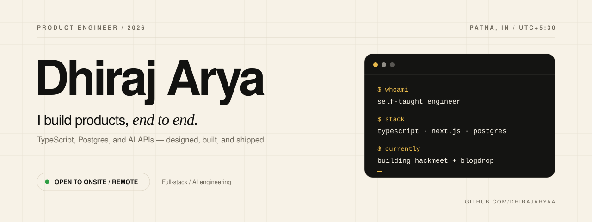

<picture>
  <source media="(prefers-color-scheme: dark)" srcset="./assets/hero-dark.svg">
  <source media="(prefers-color-scheme: light)" srcset="./assets/hero-light.svg">
  
</picture>

  <b>Full-stack engineer</b> · Patna, India · Open to onsite / remote
   
  <a href="https://dhirajarya.in">Portfolio</a> ·
  <a href="https://dhirajarya.in/resume.pdf">Resume</a> ·
  <a href="https://linkedin.com/in/dhirajarya01">LinkedIn</a> ·
  <a href="https://twitter.com/dhirajarya01">X</a> ·
  <a href="mailto:hello@dhirajarya.in">Email</a>

I build SaaS products, developer tools, and small utilities end to end — mostly with TypeScript, Next.js, Postgres, and AI APIs. I'm self-taught, product-first, and looking for a full-stack or AI-product engineering role, onsite or remote.

I'm most useful on a small team that needs someone to take a feature from schema to shipped UI.

## Currently building

**HackMeet** — live 1:1 video rooms for developers. GitHub-verified, with a skip button when the conversation isn't working. WebRTC carries the media; Socket.IO handles signaling and matchmaking; the client and server share TypeScript types.

The beta is in development and the waitlist is open. [Visit HackMeet →](https://hackmeet.dhirajarya.in)

## Selected work

**[BlogDrop](https://blogdrop.in)** — turns RSS feeds into one clean reading feed. Cheerio extracts each article; Gemini writes the summary, tags, and key takeaways; Inngest runs ingestion with retries and rate limits.  
`Next.js` `Postgres` `Drizzle` `Inngest` `Gemini` · [Code](https://github.com/dhirajaryaa/blogdrop)

**[QueryMate](https://querymate.dhirajarya.in)** — ask a Postgres or MySQL database a question in plain English. It reads the schema, generates the query, and returns the result table in chat.  
`Next.js` `Postgres` `MySQL` `Drizzle` `Vercel AI SDK` `Groq` · [Code](https://github.com/dhirajaryaa/QueryMate)

**[SmartForm](https://www.youtube.com/watch?v=Wan9QWfXF-Y)** — a Chrome extension that reads form labels and context, asks Gemini or Groq for the values, and fills the fields. The user stays in control of the final submit.  
`TypeScript` `React` `WXT` `Gemini` `Groq` · [Code](https://github.com/dhirajaryaa/smartform)

## Also shipped

Five live utilities: [Temp Mail](https://tempmail.dhirajarya.in), [Compressly](https://compressly.dhirajarya.in), [LowPDF](https://lowpdf.dhirajarya.in), [PDFAny](https://pdfany.dhirajarya.in), and [Snapshot](https://snapshot.dhirajarya.in). LowPDF and PDFAny process files entirely in the browser — no upload, no server copy.

## Stack

**Frontend** — TypeScript, React, Next.js (App Router), Tailwind, shadcn/ui, Zustand, TanStack Query  
**Backend** — Node.js, Express, PostgreSQL, Drizzle, Better Auth, Inngest  
**AI & realtime** — Gemini, Groq, Vercel AI SDK, Socket.IO, WebRTC  
**Tooling** — Bun, GitHub Actions, Vercel, WXT, Arch Linux

## Writing

[Why I Built BlogDrop](https://dhirajarya.in/blog/why-i-built-blogdrop) — the ingestion loop, the cleanup, and the parts that broke.  
[Next.js App Router in Practice](https://dhirajarya.in/blog/nextjs-app-router-in-practice) — six months of production code: what held up and what I reverted.

## About

I learned to code by shipping. Pick a problem, build the whole thing, put it online, then fix what real use exposes. That's still how I work — schema, API, UI, deploy.

I care about the unglamorous parts: clean data models, background jobs that can retry, error states, and pages that stay fast on a weak connection. I work from Arch Linux with Hyprland, mostly in Kitty, with Vim keys in VS Code.

## Contact

Open to full-stack and AI-product roles, onsite or remote, and to interesting freelance builds.

[hello@dhirajarya.in](mailto:hello@dhirajarya.in) · [Resume](https://dhirajarya.in/resume.pdf) · [LinkedIn](https://linkedin.com/in/dhirajarya01) · [X](https://twitter.com/dhirajarya01)
